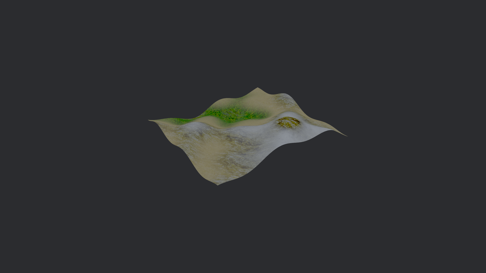
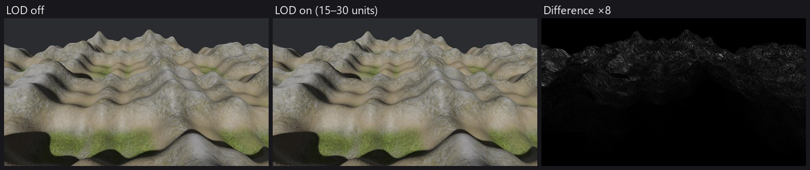

# PlumeSplat

**Advanced terrain splatting for Bevy with support for up to 256 materials in a single draw call.**

PlumeSplat is a high-performance terrain material blending library for the [Bevy](https://bevyengine.org) game engine. It extends Bevy's `StandardMaterial` with powerful texture array splatting, enabling complex multi-material terrains with full PBR support.



## Features

- **256 Material Support** - Blend up to 256 different materials using texture arrays and per-vertex indices
- **Single Draw Call** - All materials rendered in one efficient draw call
- **Full PBR Integration** - Extends `StandardMaterial` for proper lighting, shadows, and reflections
- **Triplanar Mapping** - UV-less texturing that works on any geometry without seams
- **Normal Maps** - Per-material normal mapping for surface detail
- **Packed PBR Textures** - Support for metallic, roughness, ambient occlusion, and height maps
- **Stochastic Tiling** - Eliminates visible texture repetition patterns
- **Stochastic Rotation** - Optional random tile rotation, global or per layer
- **Multi-Scale Blending** - Combines multiple texture frequencies to reduce repetition
- **Distance LOD** - Optional: skips normal maps and sharpens triplanar blending far from the camera, with a smooth fade (~20% faster terrain pass on distant views)
- **Height-Based Blending** - Natural material transitions based on height maps
- **Configurable Blend Sharpness** - Control how materials transition at boundaries
- **Builder API** - Ergonomic API that automatically combines individual textures into arrays

## Installation

Add PlumeSplat to your `Cargo.toml`:

```toml
[dependencies]
plumesplat = "0.1"
bevy = "0.18"
```

## Quick Start (Builder API - Recommended)

The easiest way to use PlumeSplat is with the builder API. Simply define your material layers with individual textures, and PlumeSplat automatically combines them into optimized texture arrays when they finish loading:

```rust
use bevy::prelude::*;
use plumesplat::prelude::*;

fn main() {
    App::new()
        .add_plugins(DefaultPlugins)
        .add_plugins(PlumeSplatPlugin)
        .add_systems(Startup, setup)
        .run();
}

fn setup(
    mut commands: Commands,
    mut meshes: ResMut<Assets<Mesh>>,
    asset_server: Res<AssetServer>,
) {
    // Define material layers - each with its own textures
    let grass = MaterialLayer::new(asset_server.load("grass_albedo.png"))
        .with_normal(asset_server.load("grass_normal.png"));

    let rock = MaterialLayer::new(asset_server.load("rock_albedo.png"))
        .with_normal(asset_server.load("rock_normal.png"))
        .with_pbr(asset_server.load("rock_pbr.png"));

    // Build the material - textures are combined automatically!
    let pending_material = SplatMaterialBuilder::new()
        .add_layer(grass)
        .add_layer(rock)
        .with_uv_scale(2.0)
        .with_triplanar_sharpness(4.0)
        .build();

    // Spawn with mesh - material auto-creates when textures load
    commands.spawn((
        Mesh3d(meshes.add(create_terrain_mesh())),
        pending_material,
    ));
}
```

### How the Builder Works

1. **Define Layers**: Create `MaterialLayer` instances with individual texture files
2. **Configure Settings**: Use the builder to set UV scale, blending options, etc.
3. **Build & Spawn**: Call `.build()` to get a `PendingSplatMaterial` component
4. **Automatic Processing**: The plugin waits for all textures to load, then:
   - Combines them into texture arrays with proper mipmaps
   - Creates the final `PlumeSplatMaterial`
   - Attaches it to your entity automatically

## Material Layers

Each `MaterialLayer` represents one material in your terrain:

```rust
// Minimal: just albedo (color) texture
let grass = MaterialLayer::new(asset_server.load("grass.png"));

// With normal map for surface detail
let dirt = MaterialLayer::new(asset_server.load("dirt.png"))
    .with_normal(asset_server.load("dirt_normal.png"));

// Full PBR: albedo + normal + packed PBR texture
let rock = MaterialLayer::new(asset_server.load("rock.png"))
    .with_normal(asset_server.load("rock_normal.png"))
    .with_pbr(asset_server.load("rock_pbr.png"));

// Override a global setting for one layer (here: never rotate this rock)
let layered_rock = MaterialLayer::new(asset_server.load("layered_rock.png"))
    .with_rotation(0.0);
```

### PBR Texture Format

The PBR texture packs multiple channels:
- **R**: Metallic (0.0 = dielectric, 1.0 = metal)
- **G**: Roughness (0.0 = smooth, 1.0 = rough)
- **B**: Ambient Occlusion (0.0 = occluded, 1.0 = fully lit)
- **A**: Height (for height-based blending)

## Builder Configuration

```rust
let pending = SplatMaterialBuilder::new()
    .add_layer(grass)
    .add_layer(dirt)
    .add_layer(rock)
    // UV scale for triplanar mapping (higher = more tiling)
    .with_uv_scale(2.0)
    // Triplanar blend sharpness (higher = sharper transitions between projections)
    .with_triplanar_sharpness(4.0)
    // Height-based blending strength (0.0 = disabled)
    .with_height_blending(0.5)
    // Blend offset for sharper material transitions
    .with_blend_offset(0.1)
    // Blend exponent (higher = sharper boundaries)
    .with_blend_exponent(2.0)
    // Multi-scale albedo: far sample scale and strength (0.0 strength = off)
    .with_multi_scale(0.11, 0.6)
    // Random tile rotation (0.0 = off) for every layer without its own
    // with_rotation() override. Best for textures without a direction
    .with_stochastic_rotation(1.0)
    // Distance LOD (off by default): beyond 80 units, skip normal maps and
    // sharpen triplanar blending; fades in smoothly from 40 units
    .with_distance_lod(40.0, 80.0)
    // Custom base material settings
    .with_base_material(StandardMaterial {
        perceptual_roughness: 0.8,
        ..default()
    })
    .build();
```

### Settings Reference

| Setting | Default | Range | Description |
|---------|---------|-------|-------------|
| `uv_scale` | 1.0 | 0.1+ | Controls texture tiling density |
| `triplanar_sharpness` | 4.0 | 1.0-16.0 | Sharpness of triplanar UV transitions |
| `height_blend_sharpness` | 0.0 | 0.0+ | Height-based blending (0 = disabled) |
| `blend_offset` | 0.0 | 0.0-0.5 | Subtracts from weights for sharper transitions |
| `blend_exponent` | 1.0 | 1.0-8.0 | Power applied to weights (higher = sharper) |
| `far_scale` | 0.11 | 0.01-1.0 | Scale of the large-scale albedo sample, relative to `uv_scale` |
| `far_mix` | 0.6 | 0.0-1.0 | Strength of the large-scale albedo sample (0 = off, skips it) |
| `stochastic_rotation` | 0.0 | 0.0-1.0 | Random per-tile rotation (0 = off, 1 = any angle). Global value; layers can override it with `MaterialLayer::with_rotation` |
| `lod_near` | 0.0 | 0.0+ | Distance (world units from the camera) where distance LOD starts to fade in |
| `lod_far` | 0.0 | 0.0 or > `lod_near` | Distance where distance LOD is fully applied (0 = off). Beyond it normal maps are skipped and triplanar blending is sharpened |

See [docs/TILING_AND_VARIATION.md](docs/TILING_AND_VARIATION.md) for how stochastic tiling, rotation (global and per layer) and multi-scale sampling work together, and [docs/DISTANCE_LOD.md](docs/DISTANCE_LOD.md) for distance LOD, both with examples and comparison images.

## Vertex Attributes

Meshes must include custom vertex attributes to specify which materials to use at each vertex:

```rust
use plumesplat::prelude::*;

// Single material (no blending)
let vertex = MaterialVertex::single(0); // 100% material index 0

// Blend two materials
let vertex = MaterialVertex::blend2(0, 1, 0.5); // 50% each

// Blend three materials
let vertex = MaterialVertex::blend3(0, 1, 2, [0.5, 0.3, 0.2]);

// Blend four materials (maximum per vertex)
let vertex = MaterialVertex::blend4([0, 1, 2, 3], [0.4, 0.3, 0.2, 0.1]);

// Add attributes to your mesh
let (indices, weights) = encode_material_data(&material_vertices);
mesh.insert_attribute(ATTRIBUTE_MATERIAL_INDICES, indices);
mesh.insert_attribute(ATTRIBUTE_MATERIAL_WEIGHTS, weights);
```

Meshes also need normals (`Mesh::ATTRIBUTE_NORMAL`); UVs are not used.

> **All vertices of a triangle must use the same 4 material indices, in the same order.**
> Indices are not interpolated: the GPU takes them from one vertex of each triangle, and
> only the weights blend across it. If one vertex uses `blend2(0, 1, …)` and its
> neighbour uses `single(2)`, material 2 disappears from that triangle. A simple way to
> follow the rule is to give every vertex the same set of indices (for example
> `[0, 1, 2, 3]`) and only vary the weights, as the example does.

## Advanced: Direct Material Creation

For advanced use cases, you can bypass the builder and create materials directly with pre-combined texture arrays. The images must be loaded as **array** textures: tell the loader how many layers the stacked image holds, and keep normal maps linear:

```rust
use bevy::image::{ImageArrayLayout, ImageLoaderSettings};
use plumesplat::prelude::*;

fn setup(
    mut commands: Commands,
    mut materials: ResMut<Assets<PlumeSplatMaterial>>,
    asset_server: Res<AssetServer>,
) {
    // 4 layers stacked vertically in one PNG
    let albedo_array = asset_server
        .load_builder()
        .with_settings(|s: &mut ImageLoaderSettings| {
            s.array_layout = Some(ImageArrayLayout::RowCount { rows: 4 });
        })
        .load("terrain_albedo_array.png");
    let normal_array = asset_server
        .load_builder()
        .with_settings(|s: &mut ImageLoaderSettings| {
            s.array_layout = Some(ImageArrayLayout::RowCount { rows: 4 });
            s.is_srgb = false;
        })
        .load("terrain_normal_array.png");

    let material = PlumeSplatMaterial {
        base: StandardMaterial {
            perceptual_roughness: 0.8,
            ..default()
        },
        extension: PlumeSplatExtension::new(albedo_array)
            .with_normal_array(normal_array)
            .with_uv_scale(2.0)
            // Optional: cheaper shading beyond 40-80 world units
            .with_distance_lod(40.0, 80.0),
    };

    commands.spawn((
        Mesh3d(mesh_handle),
        MeshMaterial3d(materials.add(material)),
    ));
}
```

### Texture Array Format

When using direct creation, textures must be pre-stacked vertically:

```
+------------------+
|    Material 0    |  <- Grass (512x512)
+------------------+
|    Material 1    |  <- Dirt (512x512)
+------------------+
|    Material 2    |  <- Rock (512x512)
+------------------+
|    Material 3    |  <- Snow (512x512)
+------------------+
        = 512x2048 total
```

Images loaded this way have no mipmaps, so distant terrain will shimmer. Prefer the builder API, which generates mipmaps, unless your arrays ship with their own (for example KTX2).

## Example

Run the included example:

```bash
cargo run --example basic
```

This demonstrates:
- Builder API for material creation
- Procedural terrain mesh generation
- Height and slope-based material assignment
- 4-material blending (grass, dirt, rock, snow)
- Full PBR with normal maps

## How It Works

### Per-Vertex Material Data

Each vertex stores:
- **4 material indices** (0-255) packed into a single `u32`
- **4 blend weights** (0-255, normalized in shader) packed into a single `u32`

This allows any vertex to blend up to 4 materials from a palette of 256.

### Triplanar Mapping

Instead of traditional UV mapping, PlumeSplat projects textures from three orthogonal directions (X, Y, Z) and blends them based on the surface normal. This eliminates UV seams and works on any geometry.

### Stochastic Tiling

To prevent visible repetition patterns, PlumeSplat uses hash-based random offsets when sampling textures. This breaks up the regular grid pattern that would otherwise be visible on large terrains.

### Distance LOD

Off by default. With `with_distance_lod(near, far)`, the shader does less work
far from the camera: between `near` and `far` (world units) normal maps fade
smoothly to the geometry normal, and beyond `far` they are not sampled at all.
Triplanar blending is also sharpened there, so slopes sample fewer projections.
Colors, stochastic tiling, rotation and multi-scale sampling stay on at every
distance.



*Bench terrain with an exaggerated 15–30 unit band so the effect is visible.
Distant rock loses its normal-map relief and looks slightly flatter; up close
nothing changes (black in the difference image), and the fade has no visible
edge. Terrain pass on this view: 2.64 ms → 2.06 ms (RTX 3080, 1080p).* In a real
scene, put `near` where normal-map detail stops being visible. See
[docs/DISTANCE_LOD.md](docs/DISTANCE_LOD.md) for
details and choosing values.

### Automatic Texture Processing

When using the builder API, the plugin:
1. Monitors for entities with `PendingSplatMaterial` components
2. Waits for all referenced textures to finish loading
3. Combines them into texture arrays with mipmaps and anisotropic filtering, on a background thread
4. Creates the final material and attaches it to the entity

Entities whose layers use the same textures (for example terrain chunks) share one set of texture arrays.

Requirements and failure handling:
- Every texture must be the same size as the first layer's albedo. 8-bit and 16-bit PNGs (RGB, RGBA or grayscale) are supported.
- A texture that doesn't meet this is replaced by a default color, with a warning in the log.
- If a texture fails to load, an error is logged and the pending material is dropped.

## Compatibility

| PlumeSplat | Bevy |
|------------|------|
| 0.1.x      | 0.18 |

## License

PlumeSplat is dual-licensed under either:

- MIT License ([LICENSE-MIT](LICENSE-MIT) or http://opensource.org/licenses/MIT)
- Apache License, Version 2.0 ([LICENSE-APACHE](LICENSE-APACHE) or http://www.apache.org/licenses/LICENSE-2.0)

at your option.

## Contributing

Contributions are welcome! Please feel free to submit a Pull Request.
