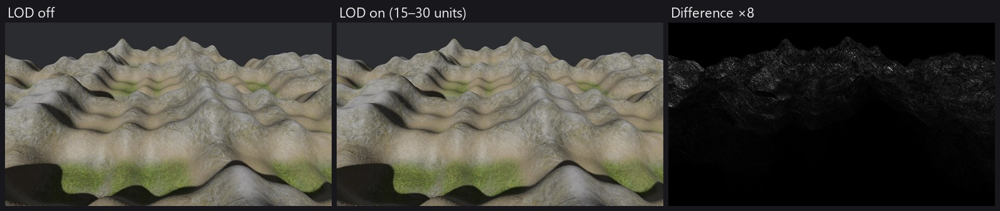
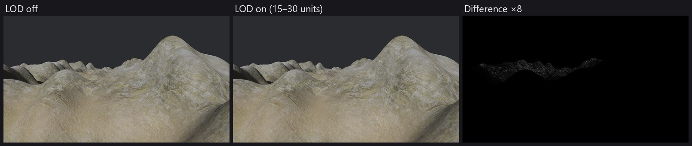
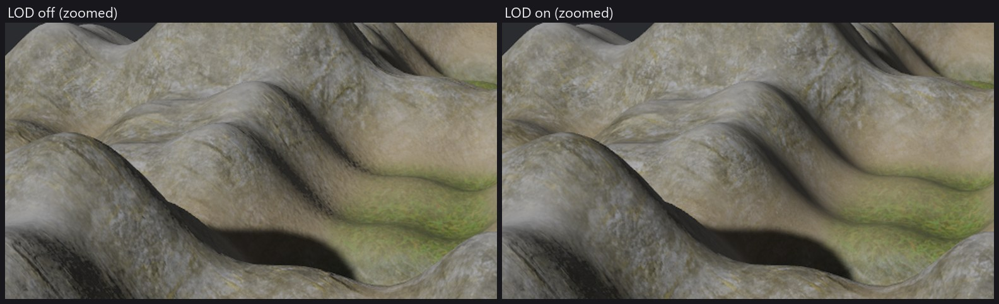

# Distance LOD

Far from the camera, small details like normal-map bumps can't be seen, but the
shader still pays for them. Distance LOD lets the shader skip that work beyond a
distance you choose, with a smooth fade so there is no visible line.

It is **off by default**. You set a fade band in world units, measured from the
camera:

| Setting | Default | Meaning |
|---|---|---|
| `lod_near` | 0.0 | Distance where the LOD starts to fade in. |
| `lod_far` | 0.0 (off) | Distance where it is fully applied. 0.0 turns LOD off. |

---

## What changes with distance

| | Closer than `lod_near` | Between `lod_near` and `lod_far` | Beyond `lod_far` |
|---|---|---|---|
| Normal maps | full | fade smoothly toward the geometry normal | not sampled; geometry normal only |
| Triplanar blending | your `triplanar_sharpness` | sharpness rises smoothly | 2× `triplanar_sharpness` (at most 16): fewer planes sampled on slopes |
| Albedo, PBR, height blending | unchanged | same textures; on slopes mixed with the sharper triplanar weights | same textures; on slopes mixed with the sharper triplanar weights |
| Stochastic tiling, rotation, multi-scale | unchanged | unchanged | unchanged |

The fade follows a smoothstep curve, so there is no visible line and no popping
when the camera moves. Without normal maps, distant surfaces also show less
specular shimmer.

Stochastic tiling, rotation and multi-scale sampling
([Hiding texture repetition](TILING_AND_VARIATION.md)) are deliberately left on:
far away is where repetition is most visible.

---

## Setting it

```rust
// Builder
SplatMaterialBuilder::new()
    // ...layers...
    .with_distance_lod(40.0, 80.0)
    .build();

// Without the builder
PlumeSplatExtension::new(albedo_array).with_distance_lod(40.0, 80.0);
```

### Changing it at runtime

Both values live on the material asset and can be changed at any time, e.g.
from a graphics quality setting:

```rust
use bevy::prelude::*;
use plumesplat::prelude::*;

fn toggle_lod(
    keys: Res<ButtonInput<KeyCode>>,
    terrain: Query<&MeshMaterial3d<PlumeSplatMaterial>>,
    mut materials: ResMut<Assets<PlumeSplatMaterial>>,
) {
    if !keys.just_pressed(KeyCode::KeyL) {
        return;
    }
    for handle in &terrain {
        let Some(mut material) = materials.get_mut(handle) else { continue };
        let s = &mut material.extension.settings;
        if s.lod_far > 0.0 {
            s.lod_far = 0.0; // off
        } else {
            s.lod_near = 40.0;
            s.lod_far = 80.0; // when setting fields directly, keep lod_far > lod_near
        }
    }
}
```

---

## What it looks like

The bench terrain (4 layers, normal maps on grass, dirt and rock), with an
exaggerated 15–30 unit band so the effect falls inside this small scene.
The difference panel is amplified 8×: black means identical.





- **Up close** (the foreground in both views) nothing changes.
- **The fade** shows as a smooth gradient in the difference image, with no edge.
- **Far away** the rock loses the fine lighting from its normal map and
  looks a little flatter and smoother. Colors and tiling stay the same, apart
  from slightly sharper transitions between projections on steep slopes.

Zoomed into the area of the overview with the largest difference:



This is the trade-off: at 15–30 units the flattening is visible when you
look for it. With a band placed where the detail is already sub-pixel, as
recommended below, it isn't.

---

## Choosing values

- Put `lod_near` where the normal map's detail stops being visible. A good
  starting point is the distance where one texture repeat (`1 / uv_scale`
  world units) covers only a few pixels. Then move it closer until you
  notice the flattening, and back off a little.
- Use a wide band (`lod_far` about twice `lod_near`) so the transition is hard to see.
- The gain grows with the share of the screen beyond `lod_far`: large open
  terrain and low camera angles benefit most. A camera close to the ground
  that never sees far gains nothing (and loses nothing).
- With orthographic cameras, the distance is still measured from the camera
  position.
- `with_distance_lod` clamps `near` to ≥ 0 and keeps `far` above `near`. To
  turn LOD off again, set `lod_far` to 0.0.
- Materials without a normal array still get the triplanar sharpening.

---

## Cost

The LOD makes rendering cheaper; it doesn't add cost. Off, or with everything
closer than `lod_near`, the images are identical to before and the timing is
the same. Terrain pass (`main_opaque_pass_3d`) on the bench (RTX 3080,
1920x1080, band 15–30 units), LOD off → on:

| View | Off | On | Change |
|---|---|---|---|
| overview | 2.64 ms | 2.06 ms | **−22%** |
| grazing | 3.19 ms | 2.61 ms | **−18%** (−24% in a second run) |
| closeup (camera ~3 units away) | 2.22 ms | 2.18 ms | ~ same, images identical |
| topdown (mostly closer than 15 units) | 1.41 ms | 1.40 ms | ~ same |

About half of the gain comes from skipping normal maps and half from the
sharper triplanar blending.

---

## Quick reference

| What | Builder | Extension (no builder) | Runtime field |
|---|---|---|---|
| Distance LOD | `SplatMaterialBuilder::with_distance_lod(near, far)` | `PlumeSplatExtension::with_distance_lod(near, far)` | `extension.settings.lod_near`, `extension.settings.lod_far` |

## Troubleshooting

- **Distant terrain looks flat**: that is distance LOD removing normal maps.
  Raise `lod_near` / `lod_far`, or set `lod_far` to 0.0 to turn it off.
- **No speed-up**: little of the screen is beyond `lod_far`. Lower the band, or
  accept that close-up views have nothing to save.
- **Odd results after editing the fields directly**: keep `lod_far` greater
  than `lod_near` (the builder methods do this for you). Only `lod_far = 0.0`
  turns LOD off.

## Upgrading from older versions

Existing code renders the same: distance LOD is off by default.

`PlumeSplatSettings` gained two public fields, `lod_near` and `lod_far`. Code
that builds it with a struct literal must add them (0.0 for both keeps LOD off)
or end with `..default()`. Code using the builder methods or `..default()`
needs no changes.
