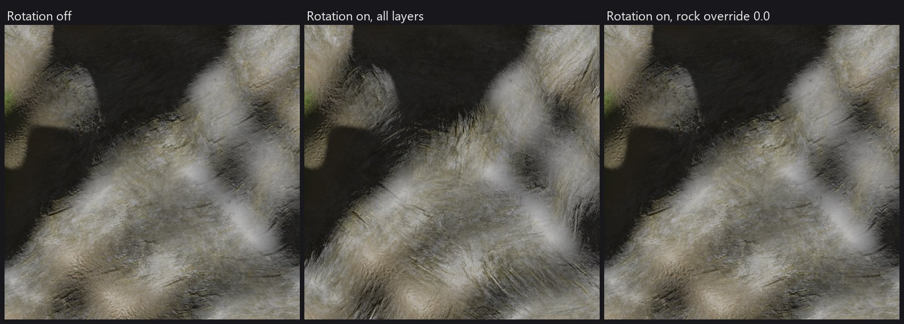
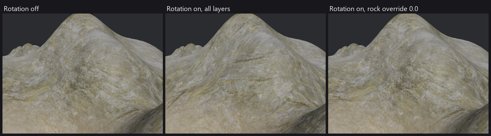

# Hiding texture repetition

A terrain covers a large area with a few small, tiling textures. Left alone,
the eye quickly finds the repeating grid. PlumeSplat has three tools against
that, and they work together:

| Tool | What it does | Default | Cost |
|---|---|---|---|
| [Stochastic tiling](#stochastic-tiling) | Gives every tile a random offset and blends neighbouring tiles | Always on | Built in |
| [Stochastic rotation](#stochastic-rotation) | Also gives every tile a random rotation, globally or per layer | Off | ~0–2.5% of the terrain pass |
| [Multi-scale sampling](#multi-scale-sampling) | Brightens and darkens each layer with a much larger copy of itself | On (`far_mix` 0.6) | Up to 3 extra texture taps per layer |

All three apply to albedo, normal and PBR textures consistently, so lighting
stays correct.

---

## Stochastic tiling

Always on, nothing to configure. The texture is split into tiles (one tile =
one texture repeat, set by `uv_scale`). Each tile is shifted by a random
offset, and neighbouring tiles are blended near their edges, so there are no
seams. Most pixels need only 1 or 2 texture samples.

The random offsets come from an integer hash of the tile's coordinates, so the
pattern is the same on every GPU and stays stable far from the world origin.

---

## Stochastic rotation

Offsets alone still leave every tile facing the same way, and at a distance
that alignment is visible. Rotation gives each tile a random angle too. Normal
maps are rotated back to match, so lighting stays correct.

**Good for** textures without a direction: grass, dirt, sand, gravel, snow,
moss, small pebbles.

**Bad for** textures with a clear direction: layered or streaky rock, planks,
tiles, rows of crops, and textures with baked directional shadows. Rotated
tiles blended together turn their lines into a crossing, hairy pattern.

That is why rotation has a **global** value plus an optional **per-layer
override**.

### How global and per-layer values combine

- The global value is set with `with_stochastic_rotation(strength)`.
- Each layer can **override** it with its own value.
- A layer **without** an override **inherits** the global value.
- An override always wins, whatever the global value is. An override of `0.0`
  means "never rotate this layer".

| Global | Layer override | Layer rotates with |
|---|---|---|
| 0.0 (default) | none | 0.0, off |
| 1.0 | none | 1.0 |
| 1.0 | 0.0 | 0.0, off |
| 0.0 | 1.0 | 1.0 |
| 1.0 | 0.5 | 0.5 |

Strength is 0.0–1.0 (values outside are clamped): 1.0 allows any angle, 0.5
limits rotation to ±90°, 0.25 to ±45°. Lower values are a middle ground for
textures with only a mild direction.

### Builder: rotate everything except one layer

The usual case. Turn rotation on globally and opt out the directional layers:

```rust
use bevy::prelude::*;
use plumesplat::prelude::*;

fn setup(mut commands: Commands, asset_server: Res<AssetServer>) {
    let grass = MaterialLayer::new(asset_server.load("grass.png"))
        .with_normal(asset_server.load("grass_normal.png"));      // inherits 1.0

    let dirt = MaterialLayer::new(asset_server.load("dirt.png"))
        .with_normal(asset_server.load("dirt_normal.png"));       // inherits 1.0

    let rock = MaterialLayer::new(asset_server.load("rock.png"))
        .with_normal(asset_server.load("rock_normal.png"))
        .with_rotation(0.0);                                      // streaky: never rotated

    let snow = MaterialLayer::new(asset_server.load("snow.png"))
        .with_rotation(0.5);                                      // only ±90°

    let pending = SplatMaterialBuilder::new()
        .add_layer(grass)
        .add_layer(dirt)
        .add_layer(rock)
        .add_layer(snow)
        .with_stochastic_rotation(1.0) // global value for layers without an override
        .build();

    // Use your terrain mesh here; it needs the PlumeSplat vertex attributes.
    commands.spawn((Mesh3d(Handle::default()), pending));
}
```

`examples/basic.rs` uses this setup.

### Builder: rotate only some layers

Leave the global value at its default (0.0, off) and opt layers in:

```rust
let grass = MaterialLayer::new(asset_server.load("grass.png"))
    .with_rotation(1.0); // only grass rotates

let pending = SplatMaterialBuilder::new()
    .add_layer(grass)
    .add_layer(dirt) // inherits 0.0: off
    .add_layer(rock) // inherits 0.0: off
    .build();
```

### Without the builder

When you create `PlumeSplatExtension` yourself from pre-made texture arrays,
layers are indices into the arrays, so overrides are set by index:

```rust
let material = PlumeSplatMaterial {
    base: StandardMaterial::default(),
    extension: PlumeSplatExtension::new(albedo_array)
        .with_normal_array(normal_array)
        .with_stochastic_rotation(1.0)  // global
        .with_layer_rotation(2, 0.0)    // layer 2: never rotated
        .with_layer_rotation(3, 0.5),   // layer 3: ±90°
};
```

### Changing it at runtime

Both values live on the material asset and can be changed at any time:

- `extension.settings.stochastic_rotation`: the global value.
- `extension.layer_settings.set_rotation(layer, Some(strength))` sets an
  override; `set_rotation(layer, None)` removes it, so the layer inherits again.
- `extension.layer_settings.rotation(layer)` reads an override (`None` = inherits).

Layers that inherit follow the global value immediately; you don't need to
update them one by one.

```rust
use bevy::prelude::*;
use plumesplat::prelude::*;

fn tweak_rotation(
    keys: Res<ButtonInput<KeyCode>>,
    terrain: Query<&MeshMaterial3d<PlumeSplatMaterial>>,
    mut materials: ResMut<Assets<PlumeSplatMaterial>>,
) {
    for handle in &terrain {
        let Some(mut material) = materials.get_mut(handle) else { continue };
        let ext = &mut material.extension;

        // R: toggle the global value. Inheriting layers follow it.
        if keys.just_pressed(KeyCode::KeyR) {
            let on = ext.settings.stochastic_rotation > 0.0;
            ext.settings.stochastic_rotation = if on { 0.0 } else { 1.0 };
        }
        // T: toggle the override on layer 2.
        if keys.just_pressed(KeyCode::KeyT) {
            let next = match ext.layer_settings.rotation(2) {
                Some(_) => None,      // remove the override: inherit again
                None => Some(0.0),    // never rotate layer 2
            };
            ext.layer_settings.set_rotation(2, next);
        }
    }
}
```

### What it looks like

The bench terrain. Rock covers most of these crops, and its texture has
strong streaks:





- **Rotation off**: the reference.
- **Rotation on, all layers**: the rock's streaks cross each other and look
  hairy. This is what happens to any directional texture.
- **Rotation on, rock override 0.0**: the rock looks exactly like "off", while
  grass, dirt and snow still get rotated.

### Cost

No extra texture samples: one `sin` and `cos` per texture tap on layers where
rotation is on, plus one uniform read per layer. On the bench (RTX 3080), the
terrain pass costs 0–2.5% more with rotation on, within measurement noise.
Layers with rotation 0.0 skip the extra math entirely.

---

## Multi-scale sampling

Even with random tiles, a texture's overall brightness pattern repeats at its
tile size. Multi-scale sampling samples each layer's albedo a second time, at
a much larger scale, and uses it to brighten or darken the normal sample. The
result keeps the texture's close-up detail but adds large, slow variation that
breaks the repetition at a distance.

It is on by default:

| Setting | Default | Range | Meaning |
|---|---|---|---|
| `far_scale` | 0.11 | 0.01–1.0 | Scale of the large sample, relative to `uv_scale`. 0.11 makes it ~9x larger. |
| `far_mix` | 0.6 | 0.0–1.0 | Strength. 0.0 turns it off and skips the extra samples. |

```rust
// Builder
SplatMaterialBuilder::new()
    // ...layers...
    .with_multi_scale(0.07, 0.4) // larger, subtler variation
    .build();

// Without the builder
PlumeSplatExtension::new(albedo_array).with_multi_scale(0.07, 0.4);

// Turn it off
builder.with_multi_scale(0.11, 0.0);

// At runtime
material.extension.settings.far_mix = 0.0;
```

### Choosing values

- **`far_scale`**: avoid simple fractions such as 0.5, 0.25 or 0.1. The two
  scales then repeat in step and the pattern stays visible. Odd values like
  0.11, 0.07 or 0.13 work well.
- **`far_mix`**: raise it if large areas still look uniform, and lower it if the
  terrain looks blotchy or patchy.
- The large sample is also rotated by a fixed ~37°, so its grid never lines up
  with the normal one.
- A layer whose average color is very dark in one channel can't blow that
  channel out: the brightening is capped at 4x.

### Cost

Up to 3 extra texture samples per visible layer (one per projection plane),
plus one sample of the layer's smallest mip level. `far_mix = 0.0` removes all of them.

---

## Quick reference

| What | Builder | Extension (no builder) | Runtime field |
|---|---|---|---|
| Global rotation | `SplatMaterialBuilder::with_stochastic_rotation(s)` | `PlumeSplatExtension::with_stochastic_rotation(s)` | `extension.settings.stochastic_rotation` |
| Per-layer rotation | `MaterialLayer::with_rotation(s)` | `PlumeSplatExtension::with_layer_rotation(layer, s)` | `extension.layer_settings.set_rotation(layer, Some(s) / None)` |
| Multi-scale | `SplatMaterialBuilder::with_multi_scale(scale, mix)` | `PlumeSplatExtension::with_multi_scale(scale, mix)` | `extension.settings.far_scale`, `extension.settings.far_mix` |

## Troubleshooting

- **A layer looks hairy, or its lines cross**: it is being rotated. Give it
  `with_rotation(0.0)`, or try 0.25 for a mild direction.
- **Rotation does nothing**: the global value is 0.0 by default. Set
  `with_stochastic_rotation(...)`, or give the layer its own
  `with_rotation(...)`.
- **A per-layer override applies to the wrong layer**: builder overrides
  follow the order of `add_layer` calls. With `with_layer_rotation`, the index
  is the layer's position in the texture arrays, the same index used in
  `MaterialVertex`.
- **Repetition still visible at a distance**: raise `far_mix`, try another
  `far_scale`, and turn on rotation for layers without a direction.
- **Distant terrain looks flat**: that is distance LOD, not tiling. See
  [DISTANCE_LOD.md](DISTANCE_LOD.md).

## Upgrading from older versions

Existing code renders the same: rotation is off by default, and every layer
inherits the global value unless you give it an override. Multi-scale defaults
match the values that used to be fixed in the shader.

`PlumeSplatSettings`, `PlumeSplatExtension` and `MaterialLayer` gained new
public fields (`far_scale`, `far_mix`, `stochastic_rotation`,
`layer_settings`, `rotation`). Code that builds them with struct literals must
add the new fields or end with `..default()`. Code using the builder methods
or `..default()` needs no changes.
